# Analyst / Data Scientist

- **View:** this diagram renders in a Markdown viewer with Mermaid support.
- **Data:** [analyst.json](analyst.json).
- **Boundary:** converted source slides/notes are excluded from this skill context.

```mermaid
flowchart TD
  n0["Causal Analysis"]
  n1["Data Quality Assessment"]
  n2["Data Visualization and Reporting"]
  n3["Decision Analysis"]
  n4["Experiment Design and A/B Testing"]
  n5["Exploratory Data Analysis"]
  n6["Analytical Evidence and Handoff"]
  n7["Monte Carlo Analysis"]
  n8["Optimization"]
  n9["Regression and Predictive Modelling"]
  n10["Choosing an Analytical Method"]
  n11["Scenario Analysis"]
  n12["Segmentation and Clustering"]
  n13["Sensitivity Analysis"]
  n14["Statistical Inference"]
  n15["Time-Series Forecasting"]
  n16["Analyst / Data Scientist [skill]"]
  n17["Causal Analysis [skill]"]
  n18["Data Quality Assessment [skill]"]
  n19["Data Visualization and Reporting [skill]"]
  n20["Decision Analysis [skill]"]
  n21["Experiment Design and A/B Testing [skill]"]
  n22["Exploratory Data Analysis [skill]"]
  n23["Monte Carlo Analysis [skill]"]
  n24["Optimization [skill]"]
  n25["Regression and Predictive Modelling [skill]"]
  n26["Scenario Analysis [skill]"]
  n27["Segmentation and Clustering [skill]"]
  n28["Sensitivity Analysis [skill]"]
  n29["Statistical Inference [skill]"]
  n30["Time-Series Forecasting [skill]"]
  n0 -->|derived_from| n6
  n1 -->|derived_from| n6
  n2 -->|derived_from| n6
  n3 -->|derived_from| n6
  n4 -->|derived_from| n6
  n5 -->|derived_from| n6
  n7 -->|derived_from| n6
  n8 -->|derived_from| n6
  n9 -->|derived_from| n6
  n10 -->|derived_from| n6
  n10 -->|references| n17
  n10 -->|references| n18
  n10 -->|references| n19
  n10 -->|references| n20
  n10 -->|references| n21
  n10 -->|references| n22
  n10 -->|references| n23
  n10 -->|references| n24
  n10 -->|references| n25
  n10 -->|references| n26
  n10 -->|references| n27
  n10 -->|references| n28
  n10 -->|references| n29
  n10 -->|references| n30
  n11 -->|derived_from| n6
  n12 -->|derived_from| n6
  n13 -->|derived_from| n6
  n14 -->|derived_from| n6
  n15 -->|derived_from| n6
  n16 -->|derived_from| n6
  n16 -->|derived_from| n10
  n16 -->|uses| n17
  n16 -->|uses| n18
  n16 -->|uses| n19
  n16 -->|uses| n20
  n16 -->|uses| n21
  n16 -->|uses| n22
  n16 -->|uses| n23
  n16 -->|uses| n24
  n16 -->|uses| n25
  n16 -->|uses| n26
  n16 -->|uses| n27
  n16 -->|uses| n28
  n16 -->|uses| n29
  n16 -->|uses| n30
  n17 -->|derived_from| n0
  n17 -->|derived_from| n6
  n18 -->|derived_from| n1
  n18 -->|derived_from| n6
  n19 -->|derived_from| n2
  n19 -->|derived_from| n6
  n20 -->|derived_from| n3
  n20 -->|derived_from| n6
  n21 -->|derived_from| n4
  n21 -->|derived_from| n6
  n22 -->|derived_from| n5
  n22 -->|derived_from| n6
  n23 -->|derived_from| n6
  n23 -->|derived_from| n7
  n24 -->|derived_from| n6
  n24 -->|derived_from| n8
  n25 -->|derived_from| n6
  n25 -->|derived_from| n9
  n26 -->|derived_from| n6
  n26 -->|derived_from| n11
  n27 -->|derived_from| n6
  n27 -->|derived_from| n12
  n28 -->|derived_from| n6
  n28 -->|derived_from| n13
  n29 -->|derived_from| n6
  n29 -->|derived_from| n14
  n30 -->|derived_from| n6
  n30 -->|derived_from| n15
```

## Knowledge pages

- [Causal Analysis](../causal-analysis/index.md).
- [Data Quality Assessment](../data-quality/index.md).
- [Data Visualization and Reporting](../data-visualization/index.md).
- [Decision Analysis](../decision-analysis/index.md).
- [Experiment Design and A/B Testing](../experiment-design/index.md).
- [Exploratory Data Analysis](../exploratory-data-analysis/index.md).
- [Analytical Evidence and Handoff](../methods/evidence-and-handoff.md).
- [Monte Carlo Analysis](../monte-carlo/index.md).
- [Optimization](../optimization/index.md).
- [Regression and Predictive Modelling](../predictive-modelling/index.md).
- [Choosing an Analytical Method](../routing/index.md).
- [Scenario Analysis](../scenario-analysis/index.md).
- [Segmentation and Clustering](../segmentation-clustering/index.md).
- [Sensitivity Analysis](../sensitivity-analysis/index.md).
- [Statistical Inference](../statistical-inference/index.md).
- [Time-Series Forecasting](../time-series-forecasting/index.md).
- [Analyst / Data Scientist [skill]](../../../skills/analyst/SKILL.md).
- [Causal Analysis [skill]](../../../skills/analyst/causal-analysis/SKILL.md).
- [Data Quality Assessment [skill]](../../../skills/analyst/data-quality/SKILL.md).
- [Data Visualization and Reporting [skill]](../../../skills/analyst/data-visualization/SKILL.md).
- [Decision Analysis [skill]](../../../skills/analyst/decision-analysis/SKILL.md).
- [Experiment Design and A/B Testing [skill]](../../../skills/analyst/experiment-design/SKILL.md).
- [Exploratory Data Analysis [skill]](../../../skills/analyst/exploratory-data-analysis/SKILL.md).
- [Monte Carlo Analysis [skill]](../../../skills/analyst/monte-carlo/SKILL.md).
- [Optimization [skill]](../../../skills/analyst/optimization/SKILL.md).
- [Regression and Predictive Modelling [skill]](../../../skills/analyst/predictive-modelling/SKILL.md).
- [Scenario Analysis [skill]](../../../skills/analyst/scenario-analysis/SKILL.md).
- [Segmentation and Clustering [skill]](../../../skills/analyst/segmentation-clustering/SKILL.md).
- [Sensitivity Analysis [skill]](../../../skills/analyst/sensitivity-analysis/SKILL.md).
- [Statistical Inference [skill]](../../../skills/analyst/statistical-inference/SKILL.md).
- [Time-Series Forecasting [skill]](../../../skills/analyst/time-series-forecasting/SKILL.md).
