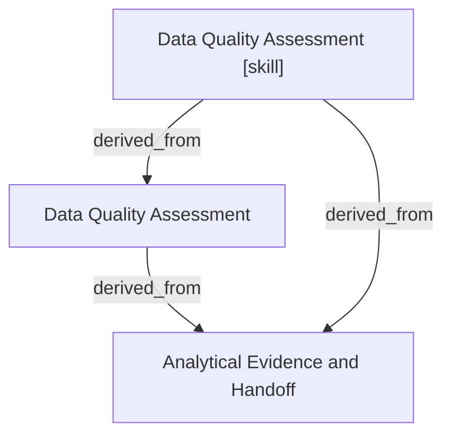

# Data Quality Assessment

- **View:** this diagram renders in a Markdown viewer with Mermaid support.
- **Data:** [data-quality.json](data-quality.json).
- **Boundary:** converted source slides/notes are excluded from this skill context.

## Knowledge pages

- [Data Quality Assessment](../data-quality/index.md).
- [Analytical Evidence and Handoff](../methods/evidence-and-handoff.md).
- [Data Quality Assessment [skill]](../../../skills/analyst/data-quality/SKILL.md).
