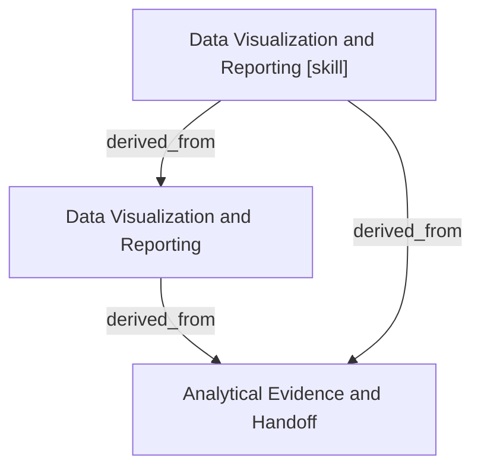

# Data Visualization and Reporting

- **View:** this diagram renders in a Markdown viewer with Mermaid support.
- **Data:** [data-visualization.json](data-visualization.json).
- **Boundary:** converted source slides/notes are excluded from this skill context.

## Knowledge pages

- [Data Visualization and Reporting](../data-visualization/index.md).
- [Analytical Evidence and Handoff](../methods/evidence-and-handoff.md).
- [Data Visualization and Reporting [skill]](../../../skills/analyst/data-visualization/SKILL.md).
