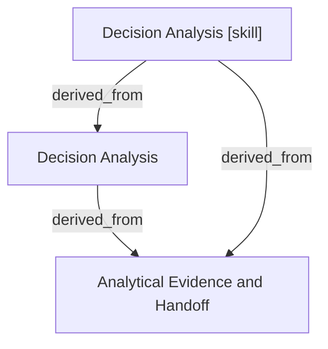

# Decision Analysis

- **View:** this diagram renders in a Markdown viewer with Mermaid support.
- **Data:** [decision-analysis.json](decision-analysis.json).
- **Boundary:** converted source slides/notes are excluded from this skill context.

## Knowledge pages

- [Decision Analysis](../decision-analysis/index.md).
- [Analytical Evidence and Handoff](../methods/evidence-and-handoff.md).
- [Decision Analysis [skill]](../../../skills/analyst/decision-analysis/SKILL.md).
