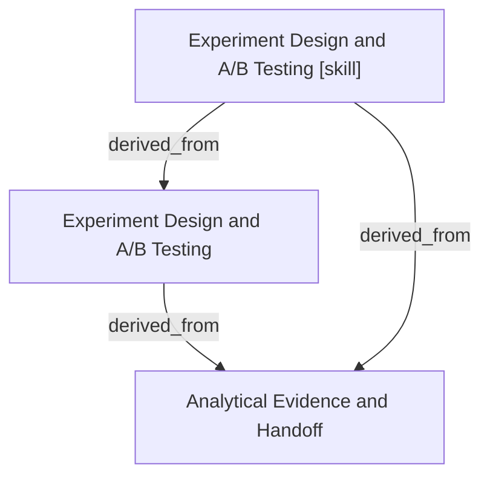

# Experiment Design and A/B Testing

- **View:** this diagram renders in a Markdown viewer with Mermaid support.
- **Data:** [experiment-design.json](experiment-design.json).
- **Boundary:** converted source slides/notes are excluded from this skill context.

## Knowledge pages

- [Experiment Design and A/B Testing](../experiment-design/index.md).
- [Analytical Evidence and Handoff](../methods/evidence-and-handoff.md).
- [Experiment Design and A/B Testing [skill]](../../../skills/analyst/experiment-design/SKILL.md).
