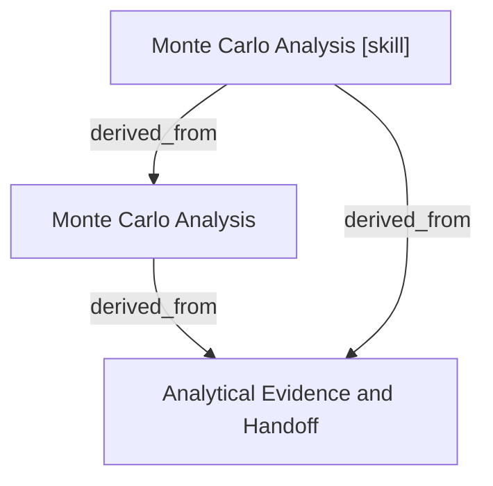

# Monte Carlo Analysis

- **View:** this diagram renders in a Markdown viewer with Mermaid support.
- **Data:** [monte-carlo.json](monte-carlo.json).
- **Boundary:** converted source slides/notes are excluded from this skill context.

## Knowledge pages

- [Analytical Evidence and Handoff](../methods/evidence-and-handoff.md).
- [Monte Carlo Analysis](../monte-carlo/index.md).
- [Monte Carlo Analysis [skill]](../../../skills/analyst/monte-carlo/SKILL.md).
