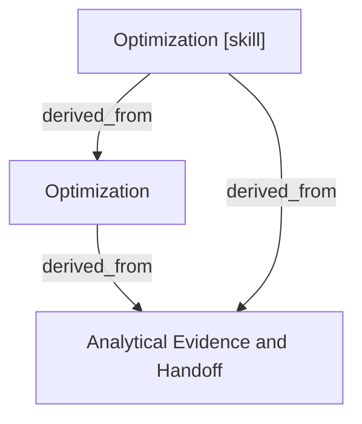

# Optimization

- **View:** this diagram renders in a Markdown viewer with Mermaid support.
- **Data:** [optimization.json](optimization.json).
- **Boundary:** converted source slides/notes are excluded from this skill context.

## Knowledge pages

- [Analytical Evidence and Handoff](../methods/evidence-and-handoff.md).
- [Optimization](../optimization/index.md).
- [Optimization [skill]](../../../skills/analyst/optimization/SKILL.md).
