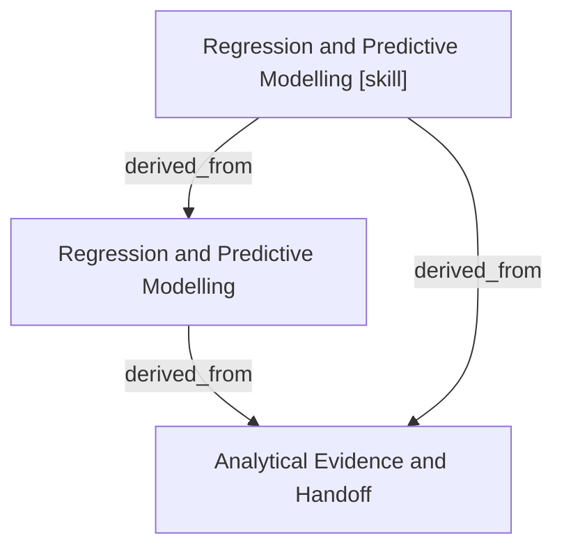

# Regression and Predictive Modelling

- **View:** this diagram renders in a Markdown viewer with Mermaid support.
- **Data:** [predictive-modelling.json](predictive-modelling.json).
- **Boundary:** converted source slides/notes are excluded from this skill context.

## Knowledge pages

- [Analytical Evidence and Handoff](../methods/evidence-and-handoff.md).
- [Regression and Predictive Modelling](../predictive-modelling/index.md).
- [Regression and Predictive Modelling [skill]](../../../skills/analyst/predictive-modelling/SKILL.md).
