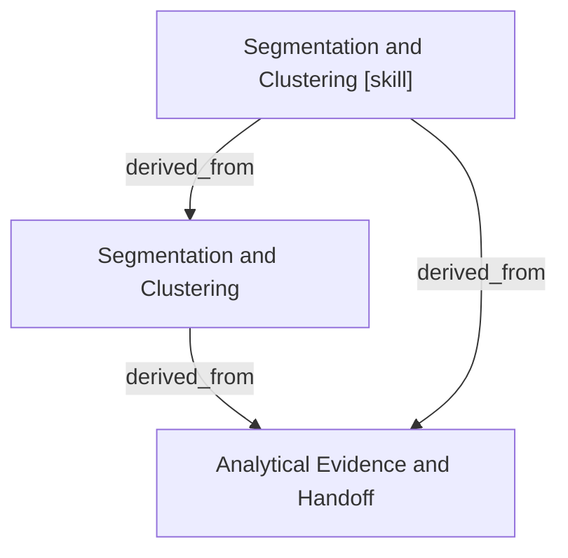

# Segmentation and Clustering

- **View:** this diagram renders in a Markdown viewer with Mermaid support.
- **Data:** [segmentation-clustering.json](segmentation-clustering.json).
- **Boundary:** converted source slides/notes are excluded from this skill context.

## Knowledge pages

- [Analytical Evidence and Handoff](../methods/evidence-and-handoff.md).
- [Segmentation and Clustering](../segmentation-clustering/index.md).
- [Segmentation and Clustering [skill]](../../../skills/analyst/segmentation-clustering/SKILL.md).
