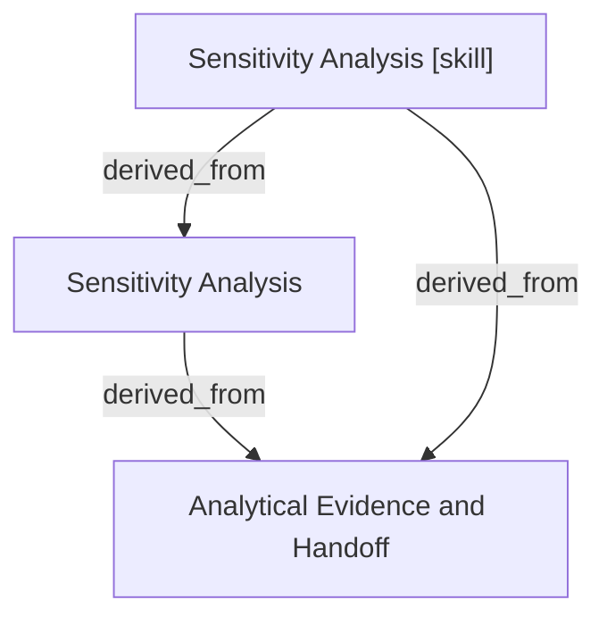

# Sensitivity Analysis

- **View:** this diagram renders in a Markdown viewer with Mermaid support.
- **Data:** [sensitivity-analysis.json](sensitivity-analysis.json).
- **Boundary:** converted source slides/notes are excluded from this skill context.

## Knowledge pages

- [Analytical Evidence and Handoff](../methods/evidence-and-handoff.md).
- [Sensitivity Analysis](../sensitivity-analysis/index.md).
- [Sensitivity Analysis [skill]](../../../skills/analyst/sensitivity-analysis/SKILL.md).
