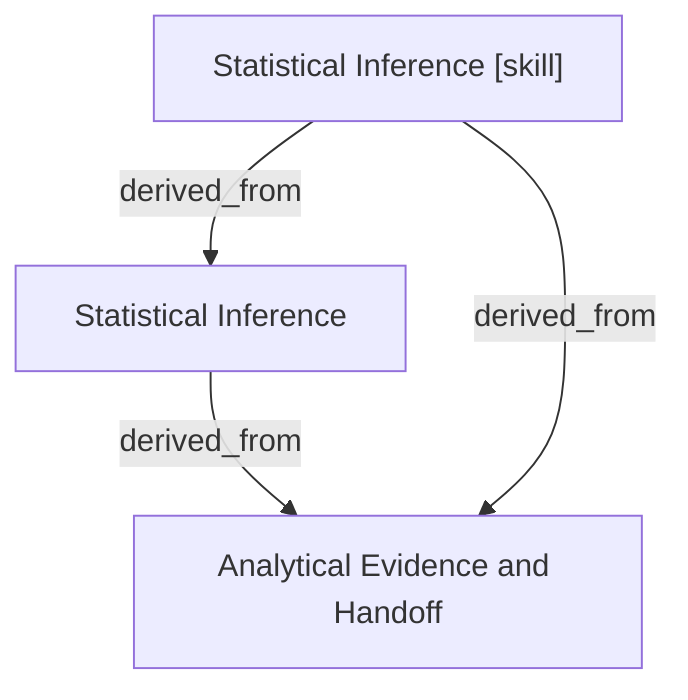

# Statistical Inference

- **View:** this diagram renders in a Markdown viewer with Mermaid support.
- **Data:** [statistical-inference.json](statistical-inference.json).
- **Boundary:** converted source slides/notes are excluded from this skill context.

## Knowledge pages

- [Analytical Evidence and Handoff](../methods/evidence-and-handoff.md).
- [Statistical Inference](../statistical-inference/index.md).
- [Statistical Inference [skill]](../../../skills/analyst/statistical-inference/SKILL.md).
