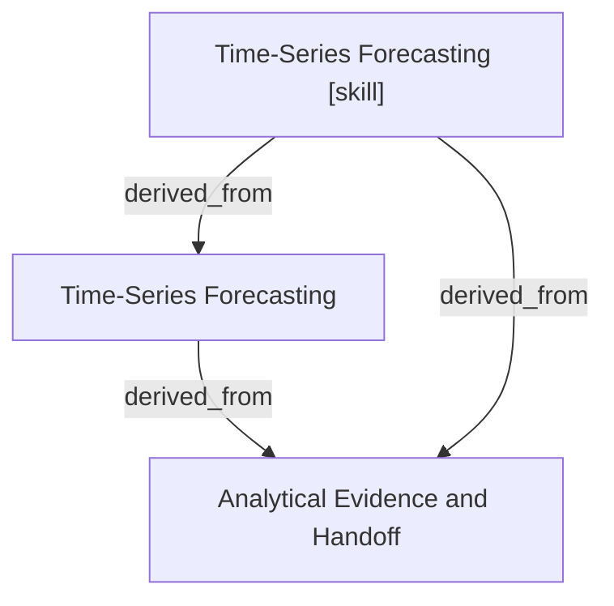

# Time-Series Forecasting

- **View:** this diagram renders in a Markdown viewer with Mermaid support.
- **Data:** [time-series-forecasting.json](time-series-forecasting.json).
- **Boundary:** converted source slides/notes are excluded from this skill context.

## Knowledge pages

- [Analytical Evidence and Handoff](../methods/evidence-and-handoff.md).
- [Time-Series Forecasting](../time-series-forecasting/index.md).
- [Time-Series Forecasting [skill]](../../../skills/analyst/time-series-forecasting/SKILL.md).
