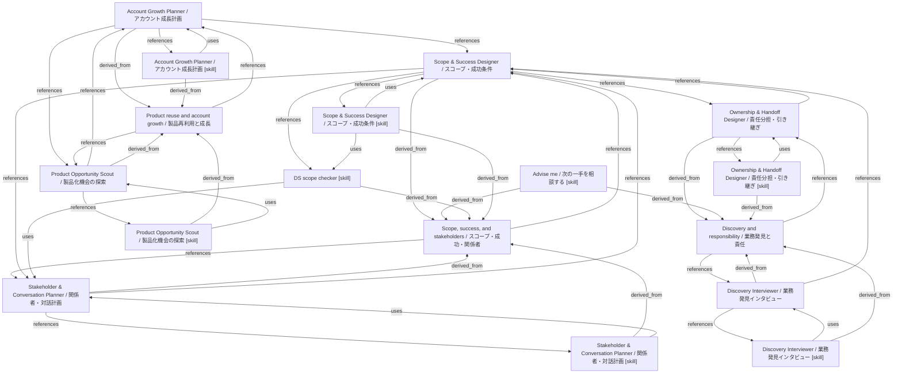

# DS knowledge graph

- **Rebuild:** run `python3 scripts/build_knowledge_graphs.py` from the repository root.
- **Validate:** run `python3 scripts/build_knowledge_graphs.py --check`.
- **Overview:** a compact map of tools, skills, and digested methods.
- **Full graph:** [ds.json](ds.json).
- **Source boundary:** background slide and note archives are not default skill knowledge.

## Skill graphs

- [account-growth](account-growth.md).
- [advise-me](advise-me.md).
- [discovery-interviewer](discovery-interviewer.md).
- [ds-scope-checker](ds-scope-checker.md).
- [ownership-handoff](ownership-handoff.md).
- [product-opportunity](product-opportunity.md).
- [scope-success](scope-success.md).
- [stakeholder-conversation](stakeholder-conversation.md).
