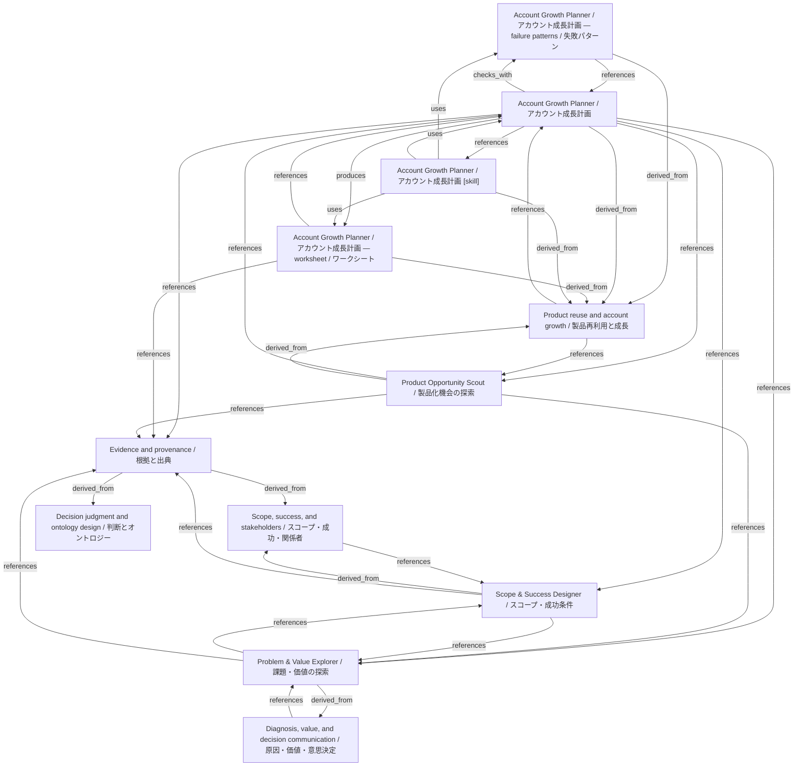

# Account Growth Planner / アカウント成長計画

- **View:** this diagram renders in a Markdown viewer with Mermaid support.
- **Data:** [account-growth.json](account-growth.json).
- **Boundary:** converted source slides/notes are excluded from this skill context.

## Knowledge pages

- [Account Growth Planner / アカウント成長計画 — failure patterns / 失敗パターン](../account-growth/failure-patterns.md).
- [Account Growth Planner / アカウント成長計画](../account-growth/index.md).
- [Account Growth Planner / アカウント成長計画 — worksheet / ワークシート](../account-growth/worksheet.md).
- [Product reuse and account growth / 製品再利用と成長](../methods/product-reuse-and-growth.md).
- [Scope, success, and stakeholders / スコープ・成功・関係者](../methods/scope-and-stakeholders.md).
- [Product Opportunity Scout / 製品化機会の探索](../product-opportunity/index.md).
- [Scope & Success Designer / スコープ・成功条件](../scope-success/index.md).
- [Evidence and provenance / 根拠と出典](../../fde/evidence-and-provenance.md).
- [Decision judgment and ontology design / 判断とオントロジー](../../fde/methods/decisions-and-ontology.md).
- [Diagnosis, value, and decision communication / 原因・価値・意思決定](../../fde/methods/diagnosis-and-value.md).
- [Problem & Value Explorer / 課題・価値の探索](../../fde/problem-value/index.md).
- [Account Growth Planner / アカウント成長計画 [skill]](../../../skills/ACCOUNT_GROWTH.md).
