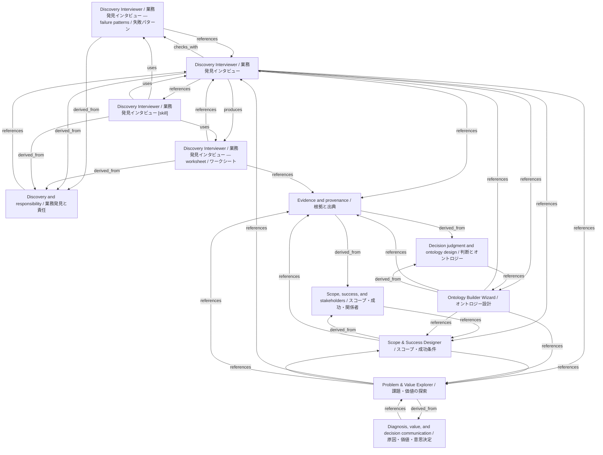

# Discovery Interviewer / 業務発見インタビュー

- **View:** this diagram renders in a Markdown viewer with Mermaid support.
- **Data:** [discovery-interviewer.json](discovery-interviewer.json).
- **Boundary:** converted source slides/notes are excluded from this skill context.

## Knowledge pages

- [Discovery Interviewer / 業務発見インタビュー — failure patterns / 失敗パターン](../discovery-interviewer/failure-patterns.md).
- [Discovery Interviewer / 業務発見インタビュー](../discovery-interviewer/index.md).
- [Discovery Interviewer / 業務発見インタビュー — worksheet / ワークシート](../discovery-interviewer/worksheet.md).
- [Discovery and responsibility / 業務発見と責任](../methods/discovery-and-ownership.md).
- [Scope, success, and stakeholders / スコープ・成功・関係者](../methods/scope-and-stakeholders.md).
- [Scope & Success Designer / スコープ・成功条件](../scope-success/index.md).
- [Evidence and provenance / 根拠と出典](../../fde/evidence-and-provenance.md).
- [Decision judgment and ontology design / 判断とオントロジー](../../fde/methods/decisions-and-ontology.md).
- [Diagnosis, value, and decision communication / 原因・価値・意思決定](../../fde/methods/diagnosis-and-value.md).
- [Ontology Builder Wizard / オントロジー設計](../../fde/ontology-builder/index.md).
- [Problem & Value Explorer / 課題・価値の探索](../../fde/problem-value/index.md).
- [Discovery Interviewer / 業務発見インタビュー [skill]](../../../skills/DISCOVERY_INTERVIEWER.md).
