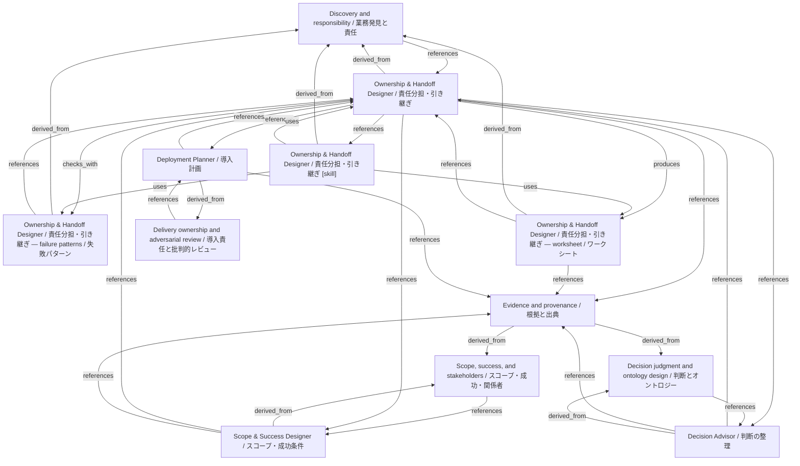

# Ownership & Handoff Designer / 責任分担・引き継ぎ

- **View:** this diagram renders in a Markdown viewer with Mermaid support.
- **Data:** [ownership-handoff.json](ownership-handoff.json).
- **Boundary:** converted source slides/notes are excluded from this skill context.

## Knowledge pages

- [Discovery and responsibility / 業務発見と責任](../methods/discovery-and-ownership.md).
- [Scope, success, and stakeholders / スコープ・成功・関係者](../methods/scope-and-stakeholders.md).
- [Ownership & Handoff Designer / 責任分担・引き継ぎ — failure patterns / 失敗パターン](../ownership-handoff/failure-patterns.md).
- [Ownership & Handoff Designer / 責任分担・引き継ぎ](../ownership-handoff/index.md).
- [Ownership & Handoff Designer / 責任分担・引き継ぎ — worksheet / ワークシート](../ownership-handoff/worksheet.md).
- [Scope & Success Designer / スコープ・成功条件](../scope-success/index.md).
- [Decision Advisor / 判断の整理](../../fde/decision-advisor/index.md).
- [Deployment Planner / 導入計画](../../fde/deployment-planner/index.md).
- [Evidence and provenance / 根拠と出典](../../fde/evidence-and-provenance.md).
- [Decision judgment and ontology design / 判断とオントロジー](../../fde/methods/decisions-and-ontology.md).
- [Delivery ownership and adversarial review / 導入責任と批判的レビュー](../../fde/methods/delivery-and-review.md).
- [Ownership & Handoff Designer / 責任分担・引き継ぎ [skill]](../../../skills/OWNERSHIP_HANDOFF.md).
