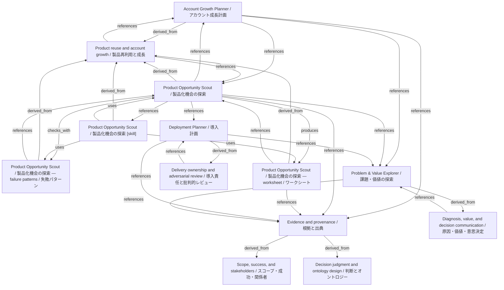

# Product Opportunity Scout / 製品化機会の探索

- **View:** this diagram renders in a Markdown viewer with Mermaid support.
- **Data:** [product-opportunity.json](product-opportunity.json).
- **Boundary:** converted source slides/notes are excluded from this skill context.

## Knowledge pages

- [Account Growth Planner / アカウント成長計画](../account-growth/index.md).
- [Product reuse and account growth / 製品再利用と成長](../methods/product-reuse-and-growth.md).
- [Scope, success, and stakeholders / スコープ・成功・関係者](../methods/scope-and-stakeholders.md).
- [Product Opportunity Scout / 製品化機会の探索 — failure patterns / 失敗パターン](../product-opportunity/failure-patterns.md).
- [Product Opportunity Scout / 製品化機会の探索](../product-opportunity/index.md).
- [Product Opportunity Scout / 製品化機会の探索 — worksheet / ワークシート](../product-opportunity/worksheet.md).
- [Deployment Planner / 導入計画](../../fde/deployment-planner/index.md).
- [Evidence and provenance / 根拠と出典](../../fde/evidence-and-provenance.md).
- [Decision judgment and ontology design / 判断とオントロジー](../../fde/methods/decisions-and-ontology.md).
- [Delivery ownership and adversarial review / 導入責任と批判的レビュー](../../fde/methods/delivery-and-review.md).
- [Diagnosis, value, and decision communication / 原因・価値・意思決定](../../fde/methods/diagnosis-and-value.md).
- [Problem & Value Explorer / 課題・価値の探索](../../fde/problem-value/index.md).
- [Product Opportunity Scout / 製品化機会の探索 [skill]](../../../skills/PRODUCT_OPPORTUNITY.md).
