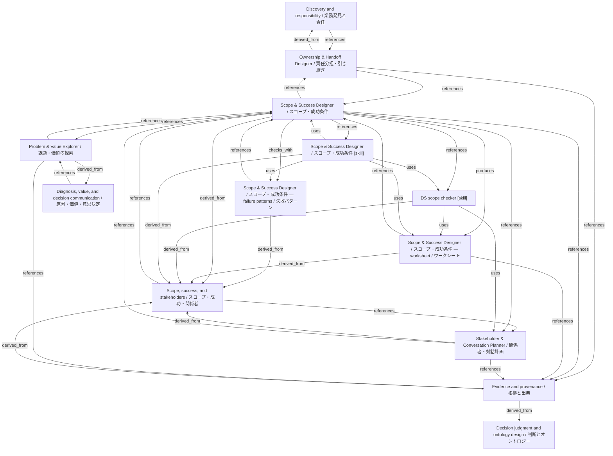

# Scope & Success Designer / スコープ・成功条件

- **View:** this diagram renders in a Markdown viewer with Mermaid support.
- **Data:** [scope-success.json](scope-success.json).
- **Boundary:** converted source slides/notes are excluded from this skill context.

## Knowledge pages

- [Discovery and responsibility / 業務発見と責任](../methods/discovery-and-ownership.md).
- [Scope, success, and stakeholders / スコープ・成功・関係者](../methods/scope-and-stakeholders.md).
- [Ownership & Handoff Designer / 責任分担・引き継ぎ](../ownership-handoff/index.md).
- [Scope & Success Designer / スコープ・成功条件 — failure patterns / 失敗パターン](../scope-success/failure-patterns.md).
- [Scope & Success Designer / スコープ・成功条件](../scope-success/index.md).
- [Scope & Success Designer / スコープ・成功条件 — worksheet / ワークシート](../scope-success/worksheet.md).
- [Stakeholder & Conversation Planner / 関係者・対話計画](../stakeholder-conversation/index.md).
- [Evidence and provenance / 根拠と出典](../../fde/evidence-and-provenance.md).
- [Decision judgment and ontology design / 判断とオントロジー](../../fde/methods/decisions-and-ontology.md).
- [Diagnosis, value, and decision communication / 原因・価値・意思決定](../../fde/methods/diagnosis-and-value.md).
- [Problem & Value Explorer / 課題・価値の探索](../../fde/problem-value/index.md).
- [DS scope checker [skill]](../../../skills/DS_SCOPE_CHECKER.md).
- [Scope & Success Designer / スコープ・成功条件 [skill]](../../../skills/SCOPE_SUCCESS.md).
