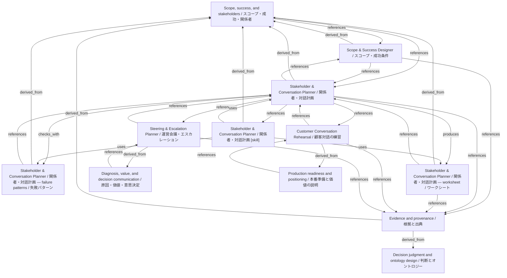

# Stakeholder & Conversation Planner / 関係者・対話計画

- **View:** this diagram renders in a Markdown viewer with Mermaid support.
- **Data:** [stakeholder-conversation.json](stakeholder-conversation.json).
- **Boundary:** converted source slides/notes are excluded from this skill context.

## Knowledge pages

- [Scope, success, and stakeholders / スコープ・成功・関係者](../methods/scope-and-stakeholders.md).
- [Scope & Success Designer / スコープ・成功条件](../scope-success/index.md).
- [Stakeholder & Conversation Planner / 関係者・対話計画 — failure patterns / 失敗パターン](../stakeholder-conversation/failure-patterns.md).
- [Stakeholder & Conversation Planner / 関係者・対話計画](../stakeholder-conversation/index.md).
- [Stakeholder & Conversation Planner / 関係者・対話計画 — worksheet / ワークシート](../stakeholder-conversation/worksheet.md).
- [Customer Conversation Rehearsal / 顧客対話の練習](../../fde/customer-conversation/index.md).
- [Evidence and provenance / 根拠と出典](../../fde/evidence-and-provenance.md).
- [Decision judgment and ontology design / 判断とオントロジー](../../fde/methods/decisions-and-ontology.md).
- [Diagnosis, value, and decision communication / 原因・価値・意思決定](../../fde/methods/diagnosis-and-value.md).
- [Production readiness and positioning / 本番準備と価値の説明](../../fde/methods/readiness-and-positioning.md).
- [Steering & Escalation Planner / 運営会議・エスカレーション](../../fde/steering-escalation/index.md).
- [Stakeholder & Conversation Planner / 関係者・対話計画 [skill]](../../../skills/STAKEHOLDER_CONVERSATION.md).
