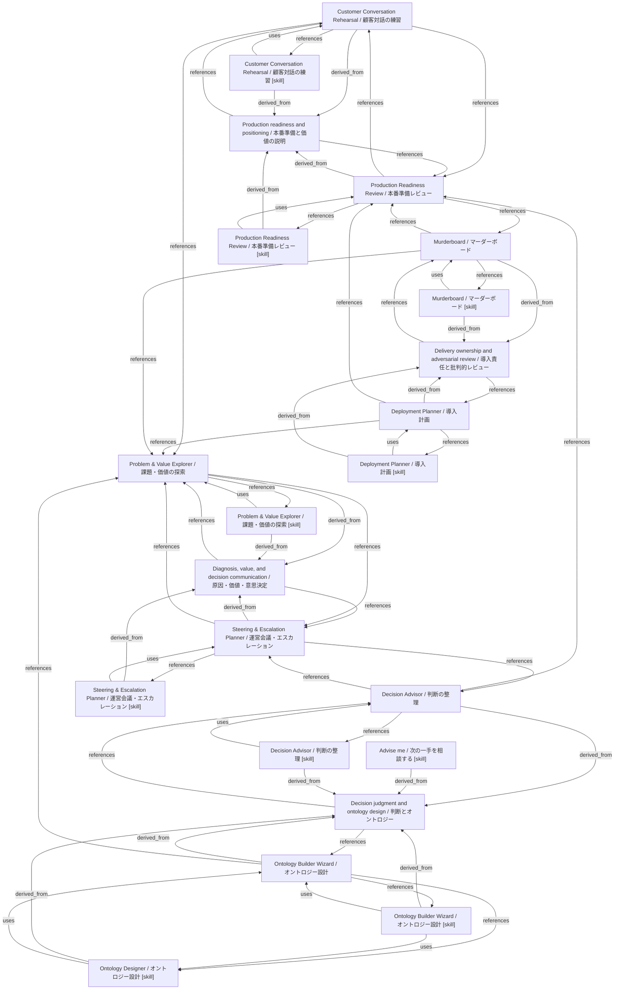

# FDE knowledge graph

- **Rebuild:** run `python3 scripts/build_knowledge_graphs.py` from the repository root.
- **Validate:** run `python3 scripts/build_knowledge_graphs.py --check`.
- **Overview:** a compact map of tools, skills, and digested methods.
- **Full graph:** [fde.json](fde.json).
- **Source boundary:** background slide and note archives are not default skill knowledge.

## Skill graphs

- [advise-me](advise-me.md).
- [builder-wizard](builder-wizard.md).
- [customer-conversation](customer-conversation.md).
- [decision-advisor](decision-advisor.md).
- [deployment-planner](deployment-planner.md).
- [murderboard](murderboard.md).
- [ontology-sketcher](ontology-sketcher.md).
- [problem-value](problem-value.md).
- [production-readiness](production-readiness.md).
- [steering-escalation](steering-escalation.md).
