# Advise me / 次の一手を相談する

- **View:** this diagram renders in a Markdown viewer with Mermaid support.
- **Data:** [advise-me.json](advise-me.json).
- **Boundary:** converted source slides/notes are excluded from this skill context.

```mermaid
flowchart TD
  n0["Discovery and responsibility / 業務発見と責任"]
  n1["Product reuse and account growth / 製品再利用と成長"]
  n2["Scope, success, and stakeholders / スコープ・成功・関係者"]
  n3["Decision judgment and ontology design / 判断とオントロジー"]
  n4["Delivery ownership and adversarial review / 導入責任と批判的レビュー"]
  n5["Diagnosis, value, and decision communication / 原因・価値・意思決定"]
  n6["Production readiness and positioning / 本番準備と価値の説明"]
  n7["Choosing the next move / 次の一手の判断例"]
  n8["When to use FDE and DS skills / FDE・DSスキルの使い分け"]
  n9["Account Growth Planner / アカウント成長計画 [skill]"]
  n10["Advise me / 次の一手を相談する [skill]"]
  n11["Ontology Builder Wizard / オントロジー設計 [skill]"]
  n12["Customer Conversation Rehearsal / 顧客対話の練習 [skill]"]
  n13["Decision Advisor / 判断の整理 [skill]"]
  n14["Deployment Planner / 導入計画 [skill]"]
  n15["Discovery Interviewer / 業務発見インタビュー [skill]"]
  n16["DS scope checker [skill]"]
  n17["Murderboard / マーダーボード [skill]"]
  n18["Ontology Designer / オントロジー設計 [skill]"]
  n19["Ownership &amp; Handoff Designer / 責任分担・引き継ぎ [skill]"]
  n20["Problem &amp; Value Explorer / 課題・価値の探索 [skill]"]
  n21["Production Readiness Review / 本番準備レビュー [skill]"]
  n22["Product Opportunity Scout / 製品化機会の探索 [skill]"]
  n23["Scope &amp; Success Designer / スコープ・成功条件 [skill]"]
  n24["Stakeholder &amp; Conversation Planner / 関係者・対話計画 [skill]"]
  n25["Steering &amp; Escalation Planner / 運営会議・エスカレーション [skill]"]
  n7 -->|derived_from| n0
  n7 -->|derived_from| n1
  n7 -->|derived_from| n2
  n7 -->|derived_from| n3
  n7 -->|derived_from| n4
  n7 -->|derived_from| n5
  n7 -->|derived_from| n6
  n7 -->|references| n8
  n8 -->|derived_from| n0
  n8 -->|derived_from| n1
  n8 -->|derived_from| n2
  n8 -->|derived_from| n3
  n8 -->|derived_from| n4
  n8 -->|derived_from| n5
  n8 -->|derived_from| n6
  n8 -->|references| n7
  n8 -->|references| n9
  n8 -->|references| n10
  n8 -->|references| n11
  n8 -->|references| n12
  n8 -->|references| n13
  n8 -->|references| n14
  n8 -->|references| n15
  n8 -->|references| n16
  n8 -->|references| n17
  n8 -->|references| n18
  n8 -->|references| n19
  n8 -->|references| n20
  n8 -->|references| n21
  n8 -->|references| n22
  n8 -->|references| n23
  n8 -->|references| n24
  n8 -->|references| n25
  n9 -->|derived_from| n1
  n10 -->|derived_from| n0
  n10 -->|derived_from| n2
  n10 -->|derived_from| n3
  n10 -->|uses| n8
  n11 -->|derived_from| n3
  n11 -->|uses| n18
  n12 -->|derived_from| n6
  n13 -->|derived_from| n3
  n14 -->|derived_from| n4
  n15 -->|derived_from| n0
  n16 -->|derived_from| n2
  n17 -->|derived_from| n4
  n18 -->|derived_from| n3
  n19 -->|derived_from| n0
  n20 -->|derived_from| n5
  n21 -->|derived_from| n6
  n22 -->|derived_from| n1
  n23 -->|derived_from| n2
  n23 -->|uses| n16
  n24 -->|derived_from| n2
  n25 -->|derived_from| n5
```

## Knowledge pages

- [Discovery and responsibility / 業務発見と責任](../../ds/methods/discovery-and-ownership.md).
- [Product reuse and account growth / 製品再利用と成長](../../ds/methods/product-reuse-and-growth.md).
- [Scope, success, and stakeholders / スコープ・成功・関係者](../../ds/methods/scope-and-stakeholders.md).
- [Decision judgment and ontology design / 判断とオントロジー](../methods/decisions-and-ontology.md).
- [Delivery ownership and adversarial review / 導入責任と批判的レビュー](../methods/delivery-and-review.md).
- [Diagnosis, value, and decision communication / 原因・価値・意思決定](../methods/diagnosis-and-value.md).
- [Production readiness and positioning / 本番準備と価値の説明](../methods/readiness-and-positioning.md).
- [Choosing the next move / 次の一手の判断例](../skill-advisor/decision-examples.md).
- [When to use FDE and DS skills / FDE・DSスキルの使い分け](../skill-advisor/index.md).
- [Account Growth Planner / アカウント成長計画 [skill]](../../../skills/ACCOUNT_GROWTH.md).
- [Advise me / 次の一手を相談する [skill]](../../../skills/ADVISE_ME.md).
- [Ontology Builder Wizard / オントロジー設計 [skill]](../../../skills/BUILDER_WIZARD.md).
- [Customer Conversation Rehearsal / 顧客対話の練習 [skill]](../../../skills/CUSTOMER_CONVERSATION.md).
- [Decision Advisor / 判断の整理 [skill]](../../../skills/DECISION_ADVISOR.md).
- [Deployment Planner / 導入計画 [skill]](../../../skills/DEPLOYMENT_PLANNER.md).
- [Discovery Interviewer / 業務発見インタビュー [skill]](../../../skills/DISCOVERY_INTERVIEWER.md).
- [DS scope checker [skill]](../../../skills/DS_SCOPE_CHECKER.md).
- [Murderboard / マーダーボード [skill]](../../../skills/MURDERBOARD.md).
- [Ontology Designer / オントロジー設計 [skill]](../../../skills/ONTOLOGY_SKETCHER.md).
- [Ownership & Handoff Designer / 責任分担・引き継ぎ [skill]](../../../skills/OWNERSHIP_HANDOFF.md).
- [Problem & Value Explorer / 課題・価値の探索 [skill]](../../../skills/PROBLEM_VALUE.md).
- [Production Readiness Review / 本番準備レビュー [skill]](../../../skills/PRODUCTION_READINESS.md).
- [Product Opportunity Scout / 製品化機会の探索 [skill]](../../../skills/PRODUCT_OPPORTUNITY.md).
- [Scope & Success Designer / スコープ・成功条件 [skill]](../../../skills/SCOPE_SUCCESS.md).
- [Stakeholder & Conversation Planner / 関係者・対話計画 [skill]](../../../skills/STAKEHOLDER_CONVERSATION.md).
- [Steering & Escalation Planner / 運営会議・エスカレーション [skill]](../../../skills/STEERING_ESCALATION.md).
