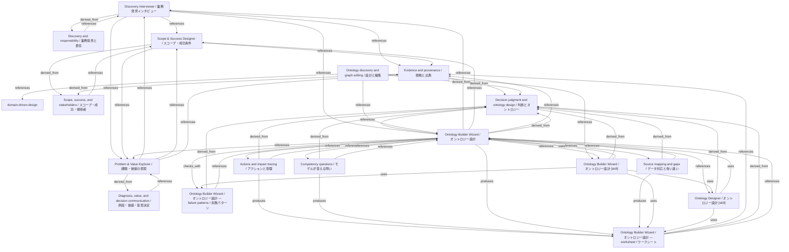

# Ontology Builder Wizard / オントロジー設計

- **View:** this diagram renders in a Markdown viewer with Mermaid support.
- **Data:** [builder-wizard.json](builder-wizard.json).
- **Boundary:** converted source slides/notes are excluded from this skill context.

## Knowledge pages

- [domain-driven-design](../../design-principles/domain-driven-design.md).
- [Discovery Interviewer / 業務発見インタビュー](../../ds/discovery-interviewer/index.md).
- [Discovery and responsibility / 業務発見と責任](../../ds/methods/discovery-and-ownership.md).
- [Scope, success, and stakeholders / スコープ・成功・関係者](../../ds/methods/scope-and-stakeholders.md).
- [Scope & Success Designer / スコープ・成功条件](../../ds/scope-success/index.md).
- [Evidence and provenance / 根拠と出典](../evidence-and-provenance.md).
- [Decision judgment and ontology design / 判断とオントロジー](../methods/decisions-and-ontology.md).
- [Diagnosis, value, and decision communication / 原因・価値・意思決定](../methods/diagnosis-and-value.md).
- [Actions and impact tracing / アクションと影響](../ontology-builder/actions-and-impact.md).
- [Competency questions / モデルが答える問い](../ontology-builder/competency-questions.md).
- [Ontology discovery and graph editing / 設計と編集](../ontology-builder/discovery-and-editing.md).
- [Ontology Builder Wizard / オントロジー設計 — failure patterns / 失敗パターン](../ontology-builder/failure-patterns.md).
- [Ontology Builder Wizard / オントロジー設計](../ontology-builder/index.md).
- [Source mapping and gaps / データ対応と食い違い](../ontology-builder/source-mapping.md).
- [Ontology Builder Wizard / オントロジー設計 — worksheet / ワークシート](../ontology-builder/worksheet.md).
- [Problem & Value Explorer / 課題・価値の探索](../problem-value/index.md).
- [Ontology Builder Wizard / オントロジー設計 [skill]](../../../skills/BUILDER_WIZARD.md).
- [Ontology Designer / オントロジー設計 [skill]](../../../skills/ONTOLOGY_SKETCHER.md).
