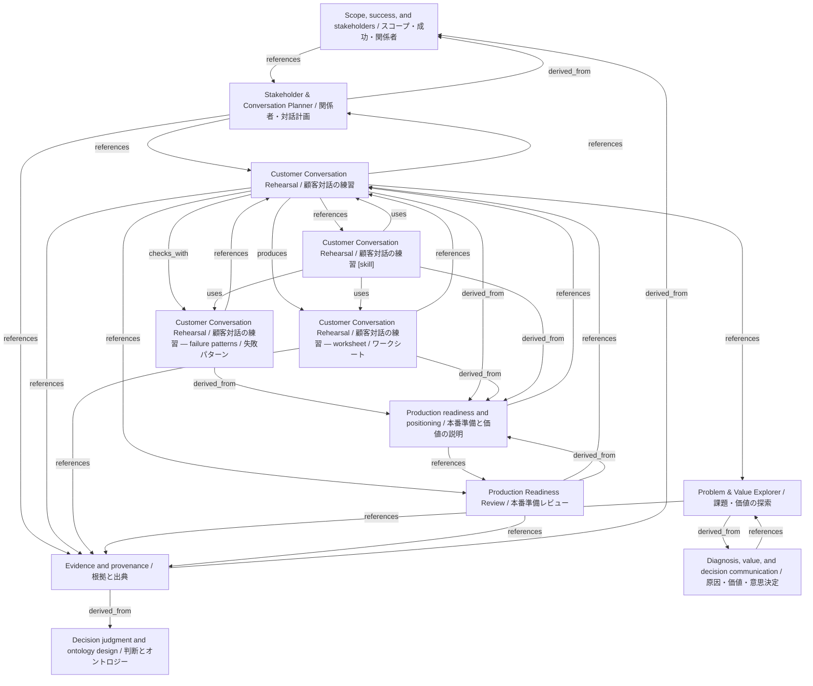

# Customer Conversation Rehearsal / 顧客対話の練習

- **View:** this diagram renders in a Markdown viewer with Mermaid support.
- **Data:** [customer-conversation.json](customer-conversation.json).
- **Boundary:** converted source slides/notes are excluded from this skill context.

## Knowledge pages

- [Scope, success, and stakeholders / スコープ・成功・関係者](../../ds/methods/scope-and-stakeholders.md).
- [Stakeholder & Conversation Planner / 関係者・対話計画](../../ds/stakeholder-conversation/index.md).
- [Customer Conversation Rehearsal / 顧客対話の練習 — failure patterns / 失敗パターン](../customer-conversation/failure-patterns.md).
- [Customer Conversation Rehearsal / 顧客対話の練習](../customer-conversation/index.md).
- [Customer Conversation Rehearsal / 顧客対話の練習 — worksheet / ワークシート](../customer-conversation/worksheet.md).
- [Evidence and provenance / 根拠と出典](../evidence-and-provenance.md).
- [Decision judgment and ontology design / 判断とオントロジー](../methods/decisions-and-ontology.md).
- [Diagnosis, value, and decision communication / 原因・価値・意思決定](../methods/diagnosis-and-value.md).
- [Production readiness and positioning / 本番準備と価値の説明](../methods/readiness-and-positioning.md).
- [Problem & Value Explorer / 課題・価値の探索](../problem-value/index.md).
- [Production Readiness Review / 本番準備レビュー](../production-readiness/index.md).
- [Customer Conversation Rehearsal / 顧客対話の練習 [skill]](../../../skills/CUSTOMER_CONVERSATION.md).
