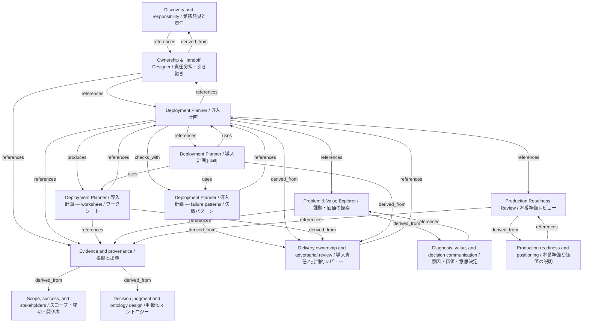

# Deployment Planner / 導入計画

- **View:** this diagram renders in a Markdown viewer with Mermaid support.
- **Data:** [deployment-planner.json](deployment-planner.json).
- **Boundary:** converted source slides/notes are excluded from this skill context.

## Knowledge pages

- [Discovery and responsibility / 業務発見と責任](../../ds/methods/discovery-and-ownership.md).
- [Scope, success, and stakeholders / スコープ・成功・関係者](../../ds/methods/scope-and-stakeholders.md).
- [Ownership & Handoff Designer / 責任分担・引き継ぎ](../../ds/ownership-handoff/index.md).
- [Deployment Planner / 導入計画 — failure patterns / 失敗パターン](../deployment-planner/failure-patterns.md).
- [Deployment Planner / 導入計画](../deployment-planner/index.md).
- [Deployment Planner / 導入計画 — worksheet / ワークシート](../deployment-planner/worksheet.md).
- [Evidence and provenance / 根拠と出典](../evidence-and-provenance.md).
- [Decision judgment and ontology design / 判断とオントロジー](../methods/decisions-and-ontology.md).
- [Delivery ownership and adversarial review / 導入責任と批判的レビュー](../methods/delivery-and-review.md).
- [Diagnosis, value, and decision communication / 原因・価値・意思決定](../methods/diagnosis-and-value.md).
- [Production readiness and positioning / 本番準備と価値の説明](../methods/readiness-and-positioning.md).
- [Problem & Value Explorer / 課題・価値の探索](../problem-value/index.md).
- [Production Readiness Review / 本番準備レビュー](../production-readiness/index.md).
- [Deployment Planner / 導入計画 [skill]](../../../skills/DEPLOYMENT_PLANNER.md).
