# Murderboard / マーダーボード

- **View:** this diagram renders in a Markdown viewer with Mermaid support.
- **Data:** [murderboard.json](murderboard.json).
- **Boundary:** converted source slides/notes are excluded from this skill context.

```mermaid
flowchart TD
  n0["anti-patterns"]
  n1["design-principles"]
  n2["Scope, success, and stakeholders / スコープ・成功・関係者"]
  n3["Scope &amp; Success Designer / スコープ・成功条件"]
  n4["Evidence and provenance / 根拠と出典"]
  n5["Decision judgment and ontology design / 判断とオントロジー"]
  n6["Delivery ownership and adversarial review / 導入責任と批判的レビュー"]
  n7["Diagnosis, value, and decision communication / 原因・価値・意思決定"]
  n8["Production readiness and positioning / 本番準備と価値の説明"]
  n9["Engineering review checks / 設計レビューの確認"]
  n10["Murderboard / マーダーボード — failure patterns / 失敗パターン"]
  n11["How to run a murderboard / 進め方"]
  n12["Murderboard / マーダーボード"]
  n13["Premortem / プレモーテム"]
  n14["Preparing the board / レビュー準備"]
  n15["Questioning techniques / 質問の組み立て"]
  n16["Decisions and follow-up / 判断・フォローアップ"]
  n17["Reviewer perspectives / レビュアーの視点"]
  n18["Murderboard / マーダーボード — worksheet / ワークシート"]
  n19["Problem &amp; Value Explorer / 課題・価値の探索"]
  n20["Production Readiness Review / 本番準備レビュー"]
  n21["Murderboard / マーダーボード [skill]"]
  n2 -->|references| n3
  n3 -->|derived_from| n2
  n3 -->|references| n4
  n3 -->|references| n19
  n4 -->|derived_from| n2
  n4 -->|derived_from| n5
  n6 -->|references| n12
  n7 -->|references| n19
  n8 -->|references| n20
  n9 -->|references| n0
  n9 -->|references| n1
  n9 -->|derived_from| n6
  n9 -->|checks_with| n10
  n9 -->|references| n12
  n9 -->|produces| n18
  n10 -->|derived_from| n6
  n10 -->|references| n12
  n11 -->|derived_from| n6
  n11 -->|references| n9
  n11 -->|references| n12
  n11 -->|references| n13
  n11 -->|references| n14
  n11 -->|references| n15
  n11 -->|references| n16
  n11 -->|references| n17
  n11 -->|produces| n18
  n12 -->|references| n3
  n12 -->|references| n4
  n12 -->|derived_from| n6
  n12 -->|references| n9
  n12 -->|checks_with| n10
  n12 -->|references| n11
  n12 -->|references| n13
  n12 -->|references| n14
  n12 -->|references| n15
  n12 -->|references| n16
  n12 -->|references| n17
  n12 -->|produces| n18
  n12 -->|references| n19
  n12 -->|references| n20
  n12 -->|references| n21
  n13 -->|derived_from| n6
  n13 -->|references| n12
  n13 -->|produces| n18
  n14 -->|derived_from| n6
  n14 -->|references| n12
  n14 -->|produces| n18
  n15 -->|derived_from| n6
  n15 -->|references| n12
  n15 -->|produces| n18
  n16 -->|derived_from| n6
  n16 -->|references| n12
  n16 -->|produces| n18
  n17 -->|derived_from| n6
  n17 -->|references| n12
  n17 -->|produces| n18
  n18 -->|references| n4
  n18 -->|derived_from| n6
  n18 -->|references| n12
  n19 -->|references| n3
  n19 -->|references| n4
  n19 -->|derived_from| n7
  n20 -->|references| n3
  n20 -->|references| n4
  n20 -->|derived_from| n8
  n20 -->|references| n12
  n21 -->|derived_from| n6
  n21 -->|uses| n10
  n21 -->|uses| n12
  n21 -->|uses| n18
```

## Knowledge pages

- [anti-patterns](../../anti-patterns.md).
- [design-principles](../../design-principles.md).
- [Scope, success, and stakeholders / スコープ・成功・関係者](../../ds/methods/scope-and-stakeholders.md).
- [Scope & Success Designer / スコープ・成功条件](../../ds/scope-success/index.md).
- [Evidence and provenance / 根拠と出典](../evidence-and-provenance.md).
- [Decision judgment and ontology design / 判断とオントロジー](../methods/decisions-and-ontology.md).
- [Delivery ownership and adversarial review / 導入責任と批判的レビュー](../methods/delivery-and-review.md).
- [Diagnosis, value, and decision communication / 原因・価値・意思決定](../methods/diagnosis-and-value.md).
- [Production readiness and positioning / 本番準備と価値の説明](../methods/readiness-and-positioning.md).
- [Engineering review checks / 設計レビューの確認](../murderboard/engineering-review-checklist.md).
- [Murderboard / マーダーボード — failure patterns / 失敗パターン](../murderboard/failure-patterns.md).
- [How to run a murderboard / 進め方](../murderboard/how-to-run.md).
- [Murderboard / マーダーボード](../murderboard/index.md).
- [Premortem / プレモーテム](../murderboard/premortem.md).
- [Preparing the board / レビュー準備](../murderboard/preparing-a-design-note.md).
- [Questioning techniques / 質問の組み立て](../murderboard/questioning-techniques.md).
- [Decisions and follow-up / 判断・フォローアップ](../murderboard/recording-decisions-and-follow-ups.md).
- [Reviewer perspectives / レビュアーの視点](../murderboard/reviewer-roles.md).
- [Murderboard / マーダーボード — worksheet / ワークシート](../murderboard/worksheet.md).
- [Problem & Value Explorer / 課題・価値の探索](../problem-value/index.md).
- [Production Readiness Review / 本番準備レビュー](../production-readiness/index.md).
- [Murderboard / マーダーボード [skill]](../../../skills/MURDERBOARD.md).
