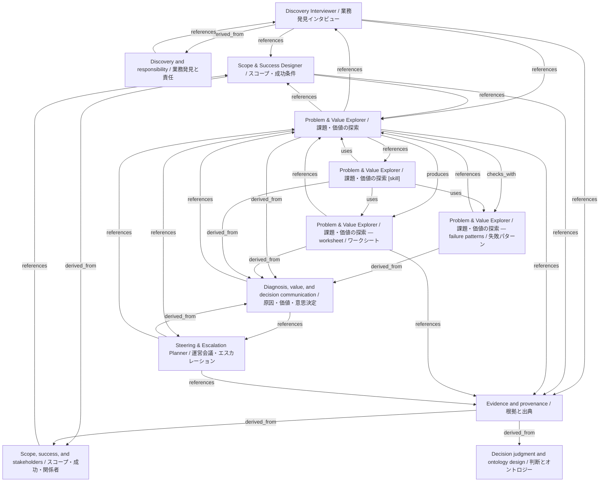

# Problem & Value Explorer / 課題・価値の探索

- **View:** this diagram renders in a Markdown viewer with Mermaid support.
- **Data:** [problem-value.json](problem-value.json).
- **Boundary:** converted source slides/notes are excluded from this skill context.

## Knowledge pages

- [Discovery Interviewer / 業務発見インタビュー](../../ds/discovery-interviewer/index.md).
- [Discovery and responsibility / 業務発見と責任](../../ds/methods/discovery-and-ownership.md).
- [Scope, success, and stakeholders / スコープ・成功・関係者](../../ds/methods/scope-and-stakeholders.md).
- [Scope & Success Designer / スコープ・成功条件](../../ds/scope-success/index.md).
- [Evidence and provenance / 根拠と出典](../evidence-and-provenance.md).
- [Decision judgment and ontology design / 判断とオントロジー](../methods/decisions-and-ontology.md).
- [Diagnosis, value, and decision communication / 原因・価値・意思決定](../methods/diagnosis-and-value.md).
- [Problem & Value Explorer / 課題・価値の探索 — failure patterns / 失敗パターン](../problem-value/failure-patterns.md).
- [Problem & Value Explorer / 課題・価値の探索](../problem-value/index.md).
- [Problem & Value Explorer / 課題・価値の探索 — worksheet / ワークシート](../problem-value/worksheet.md).
- [Steering & Escalation Planner / 運営会議・エスカレーション](../steering-escalation/index.md).
- [Problem & Value Explorer / 課題・価値の探索 [skill]](../../../skills/PROBLEM_VALUE.md).
