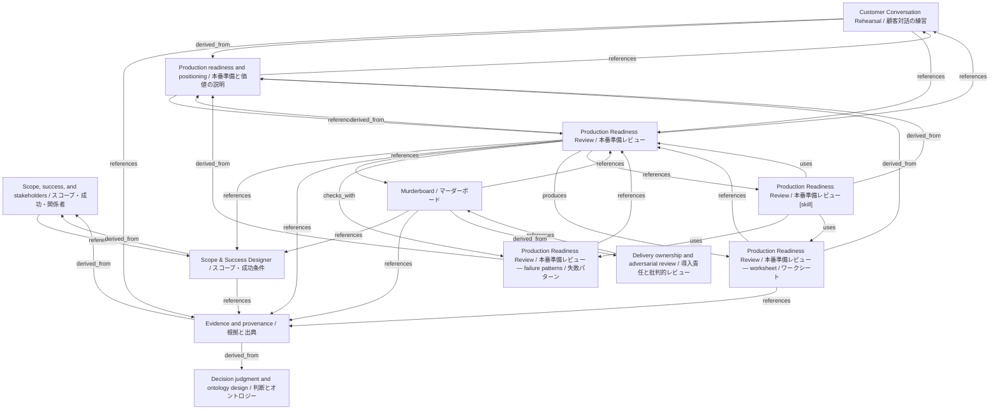

# Production Readiness Review / 本番準備レビュー

- **View:** this diagram renders in a Markdown viewer with Mermaid support.
- **Data:** [production-readiness.json](production-readiness.json).
- **Boundary:** converted source slides/notes are excluded from this skill context.

## Knowledge pages

- [Scope, success, and stakeholders / スコープ・成功・関係者](../../ds/methods/scope-and-stakeholders.md).
- [Scope & Success Designer / スコープ・成功条件](../../ds/scope-success/index.md).
- [Customer Conversation Rehearsal / 顧客対話の練習](../customer-conversation/index.md).
- [Evidence and provenance / 根拠と出典](../evidence-and-provenance.md).
- [Decision judgment and ontology design / 判断とオントロジー](../methods/decisions-and-ontology.md).
- [Delivery ownership and adversarial review / 導入責任と批判的レビュー](../methods/delivery-and-review.md).
- [Production readiness and positioning / 本番準備と価値の説明](../methods/readiness-and-positioning.md).
- [Murderboard / マーダーボード](../murderboard/index.md).
- [Production Readiness Review / 本番準備レビュー — failure patterns / 失敗パターン](../production-readiness/failure-patterns.md).
- [Production Readiness Review / 本番準備レビュー](../production-readiness/index.md).
- [Production Readiness Review / 本番準備レビュー — worksheet / ワークシート](../production-readiness/worksheet.md).
- [Production Readiness Review / 本番準備レビュー [skill]](../../../skills/PRODUCTION_READINESS.md).
