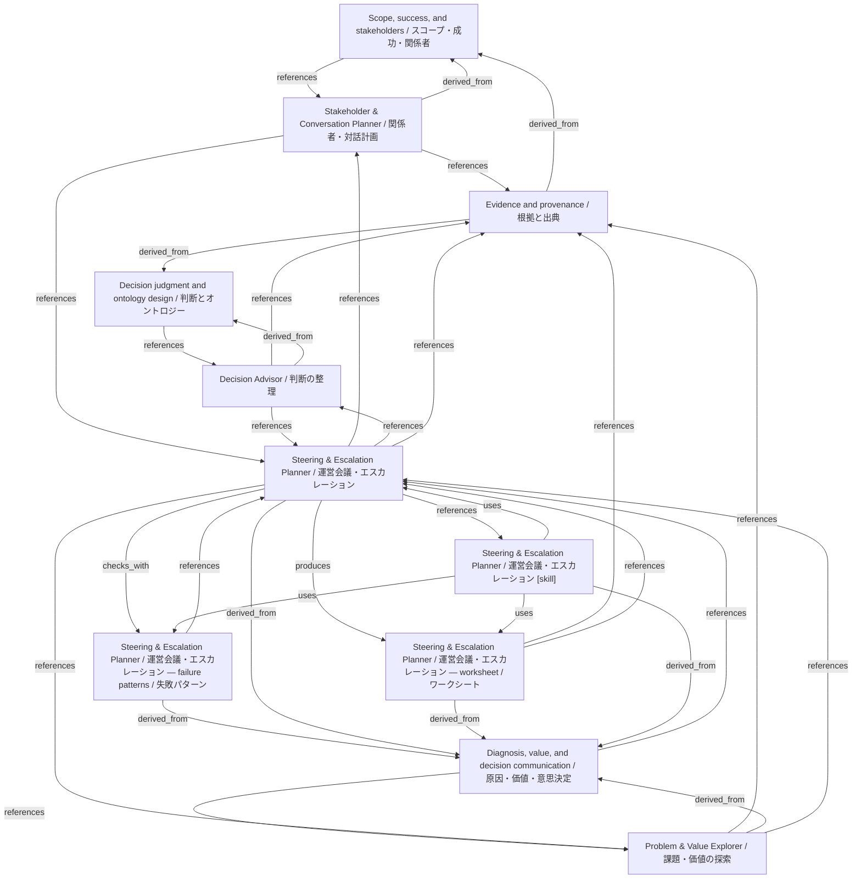

# Steering & Escalation Planner / 運営会議・エスカレーション

- **View:** this diagram renders in a Markdown viewer with Mermaid support.
- **Data:** [steering-escalation.json](steering-escalation.json).
- **Boundary:** converted source slides/notes are excluded from this skill context.

## Knowledge pages

- [Scope, success, and stakeholders / スコープ・成功・関係者](../../ds/methods/scope-and-stakeholders.md).
- [Stakeholder & Conversation Planner / 関係者・対話計画](../../ds/stakeholder-conversation/index.md).
- [Decision Advisor / 判断の整理](../decision-advisor/index.md).
- [Evidence and provenance / 根拠と出典](../evidence-and-provenance.md).
- [Decision judgment and ontology design / 判断とオントロジー](../methods/decisions-and-ontology.md).
- [Diagnosis, value, and decision communication / 原因・価値・意思決定](../methods/diagnosis-and-value.md).
- [Problem & Value Explorer / 課題・価値の探索](../problem-value/index.md).
- [Steering & Escalation Planner / 運営会議・エスカレーション — failure patterns / 失敗パターン](../steering-escalation/failure-patterns.md).
- [Steering & Escalation Planner / 運営会議・エスカレーション](../steering-escalation/index.md).
- [Steering & Escalation Planner / 運営会議・エスカレーション — worksheet / ワークシート](../steering-escalation/worksheet.md).
- [Steering & Escalation Planner / 運営会議・エスカレーション [skill]](../../../skills/STEERING_ESCALATION.md).
